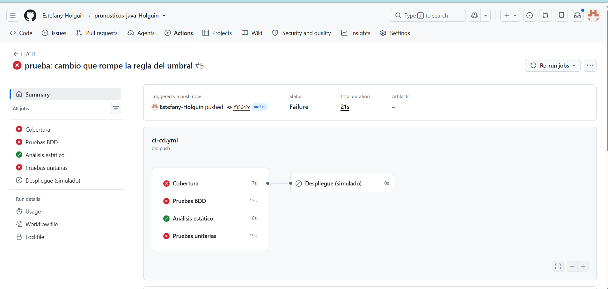
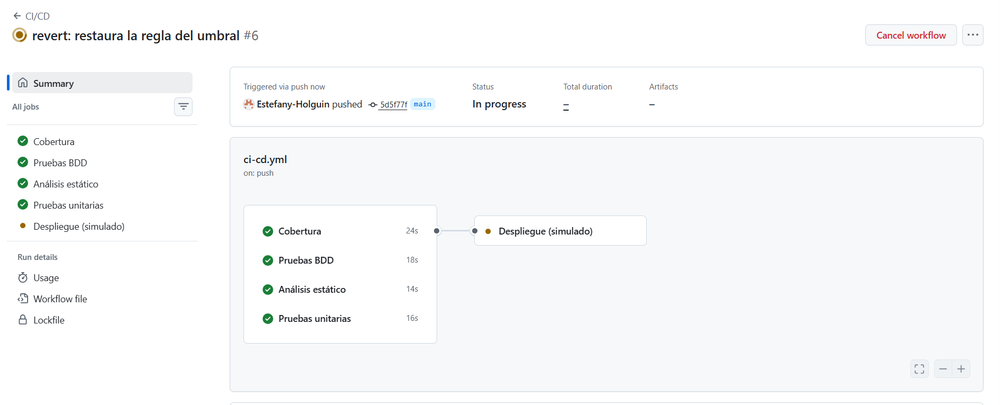
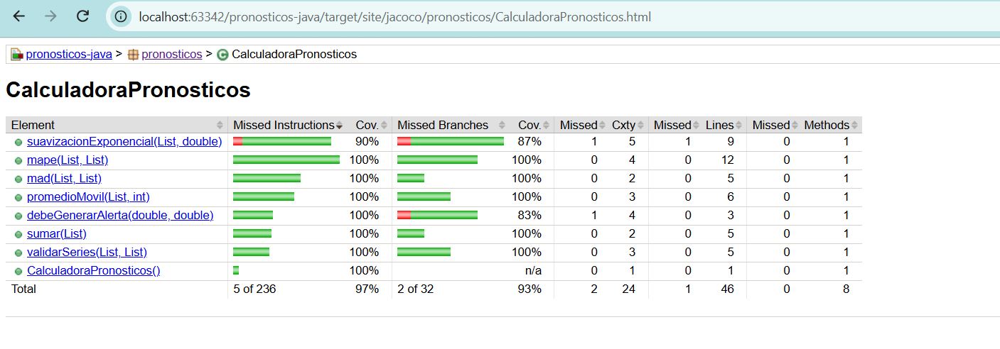

# Informe de la actividad

## Enlace al repositorio

https://github.com/Estefany-Holguin/pronosticos-java-Holguin

## Evidencias

### Pipeline en rojo — Paso 7.5

<!-- Inserta aquí la captura del pipeline en rojo del Paso 7.5. -->

### Pipeline en verde

<!-- Inserta aquí la captura del pipeline completo en verde. -->

### Reporte de JaCoCo

<!-- Inserta aquí la captura de target/site/jacoco/index.html. -->

## Respuestas

### ¿Qué vieron en el rojo del Paso 2.1 y por qué en Java suele ser un error de compilación?

La prueba intentaba llamar a `suavizacionExponencial`, pero el método todavía no existía en
`CalculadoraPronosticos`. Por eso Java mostró `cannot find symbol`: antes de ejecutar las
pruebas, Java necesita compilar tanto el código de producción como el código de prueba, y no
puede compilar una llamada a un método inexistente o inaccesible.

### ¿Por qué el MAPE del caso [80, 0, 95] se divide entre 2?

El MAPE se calcula como porcentaje y no se puede dividir entre una demanda real igual a cero.
Por eso el periodo `[0, 0]` se excluye del cálculo y solo quedan dos periodos válidos: 80 y 95.
El promedio se divide entre 2, no entre 3.

### ¿Por qué las pruebas unitarias crean la calculadora con `new` en lugar de levantar Spring?

Porque `CalculadoraPronosticos` es una clase Java sencilla, sin dependencias de Spring ni acceso
a bases de datos. Crear la clase con `new` hace que la prueba sea rápida, aislada y enfocada
únicamente en el comportamiento de la calculadora.

### ¿Qué diferencia hay entre una prueba unitaria y un escenario BDD en este proyecto?

Una prueba unitaria verifica directamente un método y sus casos específicos, como `mape` o
`debeGenerarAlerta`. Un escenario BDD describe una regla de negocio usando lenguaje cercano al
negocio, con pasos como Dado, Cuando y Entonces; Cucumber ejecuta esos pasos para comprobar
el comportamiento completo de la alerta.

### En el Paso 7.5, ¿qué pruebas fallaron y por qué el despliegue no corrió?

Falló el job de **Análisis estático** porque Checkstyle encontró un `import java.util.Map;`
sin usar, que se había agregado intencionalmente para provocar un error. Las pruebas unitarias,
BDD y cobertura sí pasaron, pero el despliegue dependía de todos esos jobs. Como el análisis
estático falló, GitHub Actions omitió el despliegue y no ejecutó el job **Despliegue
(simulado)**.
